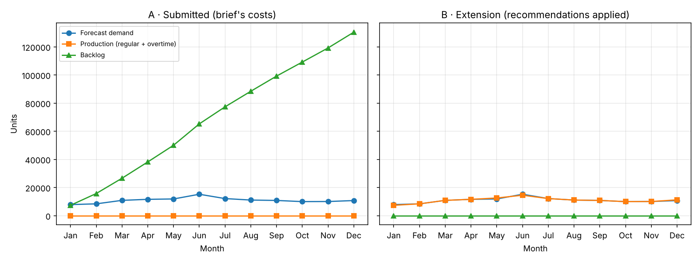

# Production Planning with Linear Programming (PuLP)

A 12-month production and inventory plan for a seasonal product, built as a linear programme in Python. It shows how one cost assumption, the **backlog penalty**, can quietly push an "optimal" plan into serving no customers at all, and how revised cost and service-level constraints fix it.

*MSc Data Science for Business, University of Bristol · Supply Chain Analytics · 2026*



## The problem

A fast-fashion retailer needs to decide how many units of a swimwear product to make each month, using regular capacity, overtime or stored inventory, while meeting a demand forecast at the lowest total cost.

Demand comes from a **Holt-Winters** forecast (built separately in R; MAPE 2.9%), which peaks in June.

| Input | Value |
|---|---|
| Regular production | 8.00 per unit, up to 14,500 units/month |
| Overtime production | 12.00 per unit, up to 1,450 units/month |
| Holding cost | 0.17 per unit per month |
| Opening and minimum closing inventory | 500 units |

## The model

For each month *t*, the decision variables are regular production *Pₜ*, overtime *Oₜ*, ending inventory *Iₜ* and backlog *Bₜ* (unmet demand carried forward).

**Minimise** Σ (8·Pₜ + 12·Oₜ + 0.17·Iₜ + b·Bₜ)

**Subject to**
- Flow balance: Iₜ₋₁ − Bₜ₋₁ + Pₜ + Oₜ = Dₜ + Iₜ − Bₜ
- Capacity: Pₜ ≤ 14,500 and Oₜ ≤ 1,450
- Closing inventory: I₁₂ ≥ 500
- Scenario B only: no backlog left at year end (B₁₂ = 0)

## Results

| | Scenario A: original costs | Scenario B: revised |
|---|---|---|
| Backlog penalty (*b*) | 0.50 per unit per month | 15.00 per unit per month |
| Backlog must be cleared by December | No | Yes |
| Units produced | **0** | 130,411 |
| Backlog in December | **130,411 units** | 0 |
| Total cost | 413,454 | 1,043,491 |

**Scenario A** looks cheaper, but only because it never produces anything. A backlog penalty of 0.50 is far below the 8.00 cost of making a unit, so the solver's cheapest choice is to defer every order, all year. Mathematically optimal; commercially absurd.

**Scenario B** sets the backlog penalty above the overtime cost and requires backlog to be cleared by year end. The plan then meets demand month by month, builds about 700 units of stock in May ahead of the June peak (when demand exceeds regular capacity), and finishes with the required 500 units.

## What this shows

- An optimisation model is only as good as its costs. When a penalty is mispriced, the "optimal" answer can be the opposite of what the business wants.
- Service-level constraints (here, clearing backlog by year end) are a simple guard against plans that look cheap on paper.
- Checking the solution, not just the solver status, matters: both scenarios report "Optimal".

## Run it

```bash
pip install -r requirements.txt
python production_planning.py
```

This prints both monthly plans and saves the chart to `outputs/scenarios.png`.

*Note: the code uses the classic PuLP 2.x API, so `requirements.txt` pins `pulp<3`.*

## Files

| File | What it is |
|---|---|
| `production_planning.py` | The model, both scenarios, results table and chart |
| `requirements.txt` | Python dependencies |
| `outputs/scenarios.png` | Demand, production and backlog for each scenario |

*This is a tidied version of my coursework code: the parameters are gathered at the top, the flow-balance constraint is written in its standard form, and Scenario B is added to illustrate the recommendation.*
